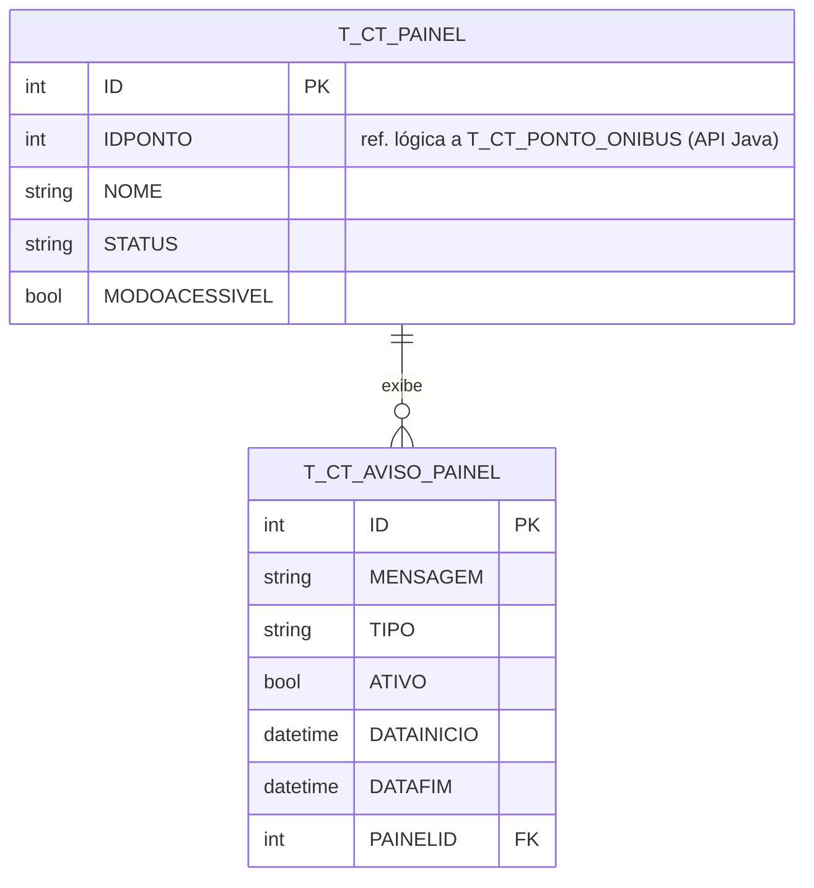

# InTransporte API de Painéis de Ponto de Ônibus (.NET)

A proposta do INTransporte é tornar o uso do transporte público mais acessível. O ponto inteligente poderá oferecer avisos sonoros, seleção de ônibus por totem e um botão de emergência.

**Cidadão beneficiado:** quem espera ônibus, principalmente idosos e pessoas com deficiência.
**ODS relacionados:** ODS 11 (Cidades e comunidades sustentáveis) e ODS 10 (Redução das desigualdades).

## Integrantes

Andre Sousa Matuda RM 566733 | Guilherme Barca Nascimento Silva RM 568517 | Guilherme Oliveira Feitosa RM 566842 | Kaliel Conceição de Aquino RM 567587 | Paulo Henrique Muniz RM 567618

## Descrição da solução

A solução é pensada para cidadãos que usam o transporte público, com atenção especial a pessoas cegas ou com baixa visão e a pessoas com mobilidade reduzida. O projeto completo prevê recursos de acessibilidade no ponto inteligente, como avisos sonoros e seleção de ônibus. A solução tem duas APIs que se complementam:

| API | Responsabilidade | Tabelas |
|---|---|---|
| **Java (Spring Boot)** | Linhas, pontos, ônibus, operações, registros de chegada, usuários e JWT. Consumida pelo app Mobile. | `T_CT_*` |
| **.NET (este repositório)** | **Gestão dos painéis (tablets) instalados nos pontos e dos avisos exibidos neles**, como desvios e alertas. | `T_CT_PAINEL`, `T_CT_AVISO_PAINEL` |


## Tecnologias

ASP.NET Core 8 (Web API com controllers) · Entity Framework Core 8 · Oracle.EntityFrameworkCore · Migrations · Swagger.

## Modelo de dados (relação 1:N)



Um painel tem vários avisos. Apagar um painel apaga seus avisos (cascade).

## Como executar

Há duas formas. A **Opção B (Docker)** não precisa de conta no Oracle da FIAP.

### Opção A: Oracle da FIAP (ambiente de desenvolvimento)

**Pré-requisitos**

- [.NET 8 SDK](https://dotnet.microsoft.com/download/dotnet/8.0)
- Git
- Ferramenta do EF Core: `dotnet tool install --global dotnet-ef --version "8.*"`
- Um usuário Oracle com permissão para criar tabelas. As Migrations criam apenas `T_CT_PAINEL` e `T_CT_AVISO_PAINEL`. Nenhuma tabela do Java é alterada.

**Passo a passo**

1. Clone e entre na pasta do projeto:
   ```bash
   git clone URL_DO_REPOSITORIO
   cd NOME_DO_REPOSITORIO/CitizenTech.Api
   ```
   (Se o `.csproj` estiver na raiz do repositório, não precisa do `cd CitizenTech.Api`.)

2. Defina a connection string **por variável de ambiente**. A senha nunca fica no repositório. Troque `SEU_RM` e `SUA_SENHA`.

   PowerShell:
   ```powershell
   $env:ConnectionStrings__Oracle="User Id=SEU_RM;Password=SUA_SENHA;Data Source=oracle.fiap.com.br:1521/ORCL"
   ```
   Linux/Mac:
   ```bash
   export ConnectionStrings__Oracle="User Id=SEU_RM;Password=SUA_SENHA;Data Source=oracle.fiap.com.br:1521/ORCL"
   ```
   São dois underscores (`__`) e sem aspas dentro do valor.

3. Restaure, compile e aplique as Migrations:
   ```bash
   dotnet restore
   dotnet build
   dotnet ef database update
   ```

4. Execute:
   ```bash
   dotnet run --launch-profile http
   ```
   O terminal mostra `Now listening on: http://localhost:XXXX`. Abra **`http://localhost:XXXX/swagger`**.

5. Confira no Oracle (SQL Developer):
   ```sql
   SELECT * FROM T_CT_PAINEL;
   SELECT * FROM T_CT_AVISO_PAINEL;
   ```

### Opção B: Docker (Oracle em container, sem conta externa)

Pré-requisito: Docker com Docker Compose.

```bash
git clone URL_DO_REPOSITORIO
cd NOME_DO_REPOSITORIO
cp .env.example .env        # edite as senhas (somente letras e números)
docker compose up -d --build
docker compose ps           # aguarde o serviço oracle ficar "healthy" (1 a 3 min)
```

Abra **`http://localhost:8080/swagger`**. As Migrations são aplicadas automaticamente quando a API sobe (`APPLY_MIGRATIONS=true`). Para consultar o banco:

```bash
docker exec -it citizentech-oracle bash -c 'sqlplus $APP_USER/$APP_USER_PASSWORD@//localhost:1521/FREEPDB1'
```
```sql
SELECT * FROM T_CT_PAINEL;
```

Para parar sem perder dados use `docker compose down`. **Não use `-v`**, que apaga o volume `oracle-data`.

## Como testar (Swagger ou curl)

| # | Requisição | Resultado esperado |
|---|---|---|
| 1 | `POST /api/paineis` | **201** |
| 2 | `GET /api/paineis` e `GET /api/paineis/1` | 200 |
| 3 | `PUT /api/paineis/1` | **204** |
| 4 | `POST /api/avisos` | **201** |
| 5 | `GET /api/paineis/ponto/1` | 200, painel com os avisos vigentes |
| 6 | `POST /api/paineis` com `"nome": ""` | **400** (JSON com os erros) |
| 7 | `GET /api/paineis/999` | **404** |
| 8 | `DELETE /api/paineis/1` | **204** (os avisos também são apagados) |

Corpo do passo 1:
```json
{ "idPonto": 1, "nome": "Painel Rua das Flores", "status": "ATIVO", "modoAcessivel": true }
```

Corpo do passo 4 (`dataInicio` anterior a agora e `dataFim` posterior, senão o aviso não aparece no passo 5):
```json
{
  "mensagem": "Linha 101 com desvio por obras na Av. Central.",
  "tipo": "ALERTA",
  "ativo": true,
  "dataInicio": "2026-11-17T00:00:00",
  "dataFim": "2026-12-31T23:59:00",
  "painelId": 1
}
```

Validações:
- `status` do painel: `ATIVO`, `INATIVO` ou `MANUTENCAO`.
- `tipo` do aviso: `INFORMATIVO`, `ALERTA` ou `EMERGENCIA`.
- `dataFim` deve ser posterior a `dataInicio`.
- `idPonto` deve ser maior que zero e único (um painel por ponto).

## Endpoints

| Recurso | Rotas |
|---|---|
| Painéis | `GET /api/paineis`, `GET /api/paineis/{id}`, `GET /api/paineis/ponto/{idPonto}`, `POST`, `PUT /{id}`, `DELETE /{id}` |
| Avisos | `GET /api/avisos`, `GET /api/avisos/{id}`, `POST`, `PUT /{id}`, `DELETE /{id}` |

## Problemas comuns

| Erro | Solução |
|---|---|
| `You must install or update .NET` / framework `8.0.0` não encontrado | Instale o .NET 8 SDK. Se houver a variável `DOTNET_ROOT` apontando para uma pasta que só tem outra versão, remova-a ou rode com `dotnet run`, que usa o `dotnet` do PATH. |
| `Value cannot be null (Parameter 'connectionString')` | A variável `ConnectionStrings__Oracle` não está definida **no mesmo terminal** em que você roda o comando. |
| `ORA-01017` | Usuário ou senha do Oracle incorretos. |
| `ORA-12154` / `ORA-12541` | O servidor Oracle não está acessível a partir da sua rede. Use a Opção B (Docker). |
| `ORA-00933` / `ORA-00907` ao aplicar a Migration | Em `Program.cs`, troque `OracleSQLCompatibility.DatabaseVersion19` por `DatabaseVersion12`. |
| `ORA-00955` (nome já em uso) | As tabelas já existem neste usuário. Use um usuário limpo ou apague `T_CT_PAINEL` e `T_CT_AVISO_PAINEL`. |
| `dotnet ef` não reconhecido | `dotnet tool install --global dotnet-ef --version "8.*"` e abra um terminal novo. |
| Tela em branco em `/` | Acesse `/swagger`. |

## Estrutura

```
Controllers/   PaineisController, AvisosController
Data/          AppDbContext
Models/        PainelPonto, AvisoPainel
Migrations/    migrations do EF Core (versionadas)
Dockerfile · docker-compose.yml · .env.example
```

## Uso de IA generativa

Foi feito uso para geração de funções que fogem do conhecimento do grupo, tratamento de alguns erros durante o desenvolvimento, auxilio para organização e Readme em partes.

## Vídeo de demonstração

https://youtu.be/JvnzQRTRoBY

